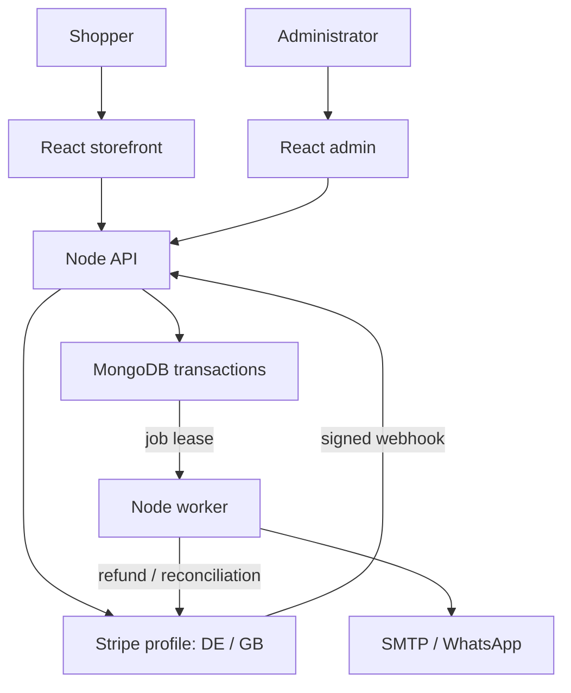
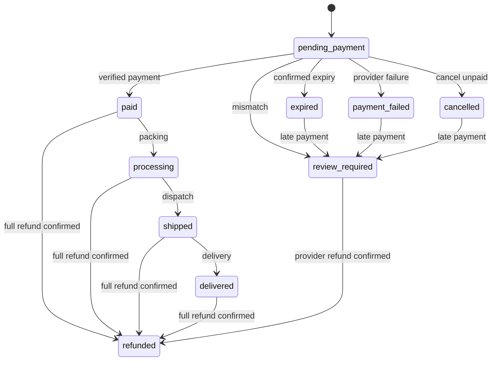

# Architecture and MongoDB model

## Boundaries

The browser talks to the Node API. Only the API/worker hold database and provider credentials. Caddy terminates HTTPS and forwards to a private API container. The Node API serves the built React storefront and admin from the same origin.

The API and worker share one MongoDB database, but run in separate processes. HTTP handlers validate inputs and create durable records. The worker claims notification/refund jobs with expiring leases and reconciles provider state. You can restart the API without deleting queued work.



This is a modular monolith with an independent worker, rather than a collection of microservices. Keeping catalogue, inventory and orders together makes transactional correctness easier to review. Native MongoDB access is the reason this project uses Node/Docker hosting.

## Collections

| Collection | Key documents/invariants |
| --- | --- |
| `products` | Stable `_id`, unique SKU/slug, DE/EN content, price in cents, publication flags, version |
| `inventory` | One document per product/market; nonnegative integer onHand/reserved; reserved ≤ onHand |
| `stockMovements` | Receipt/removal/commit/release history; unique operation+product+market |
| `orders` | Immutable checkout snapshot, unique order number/idempotency key, retained merchant profile/session |
| `paymentEvents` | Event identity includes provider, profile and provider event ID |
| `notifications` | Message snapshot, dedupe key, pending/sending/sent/failed/skipped, attempts and lease token |
| `jobs` | Durable refund requests, provider results, retries, retained for operator review |
| `adminUsers` | Password hash, role, active/lock status, encrypted MFA secret and last accepted counter |
| `adminSessions` | Hashed opaque session token and Date-based TTL expiry |
| `subscribers` | Consent text/source/date, token hash, double opt-in state |
| `withdrawals` | Withdrawal receipt reference, customer declaration and handled state |
| `settings` | Shipping, bundles, business, content and notification recipients; internal schema/worker records |
| `counters` | Atomic SKU/subscriber/withdrawal sequences |
| `media` | Content hash, URL, size and creation time; binary image lives on the uploads volume |
| `auditLogs` | Actor/action/entity/time; no passwords, raw tokens or entire request bodies |
| `rateLimits` | Shared hashed rate-limit buckets and Date-based TTL expiry |

The local-only `mockSessions` and `mockRefunds` collections persist simulated payments across restarts. Production configuration refuses the mock provider.

Application timestamps use UTC ISO strings where range comparisons use lexicographic ordering. TTL fields use actual BSON Dates; MongoDB TTL deletion is asynchronous. Session authentication explicitly checks expiry before trusting a document.

## Example order

```javascript
{
  _id: "random-uuid",
  orderNumber: "EV-7K3M9Q2A",
  idempotencyKey: "browser-generated-uuid",
  country: "DE",
  lang: "de",
  currency: "EUR",
  subtotal: 598,
  shipping: 499,
  total: 1097,
  amountPaid: null,
  amountRefunded: 0,
  refundReserved: 0,
  status: "pending_payment",
  reservationState: "held",
  reservationExpiresAt: "UTC timestamp",
  payment: {
    provider: "stripe",
    profileId: "DE",
    sessionId: "cs_...",
    intentId: null
  },
  lines: [/* frozen names, SKUs, quantities, unit prices, tax and box picks */],
  customer: {/* validated delivery address and contact details */},
  termsAcceptedAt: "UTC timestamp",
  termsVersion: "2026-10-v6",
  events: [/* status history */]
}
```

No card number, CVV or bank-login credential is stored. Customer addresses, contact details and order history are personal data and must have controlled access/retention.

## Checkout and stock

1. Validate delivery country/address, basket, terms, consent and UUID idempotency key.
2. Load the current catalogue and recalculate integer-cent totals on the server. The browser cannot choose a price.
3. In a MongoDB transaction, reserve stock with a conditional update requiring available units ≥ requested units, then insert the order snapshot.
4. Call Stripe **outside** that transaction with a stable checkout key, retained merchant profile and fixed creation-based expiration.
5. Persist the session ID. A signed webhook may arrive before attachment; account/order/session checks govern the association.
6. A verified paid event must match the retained account, session, currency, exact total and no unapproved discount, and include a payment intent.
7. In one transaction, consume reserved stock, set paid state and enqueue confirmation messages. Recording the provider event commits with these effects.
8. A duplicate event becomes a no-op. A payment mismatch moves the order to `review_required`; no fulfilment or paid confirmation occurs.
9. Failed/expired unpaid sessions release reservations. Reconciliation checks expired holds with the provider before releasing them.
10. A valid late payment after stock was released enters review and queues a durable automatic refund. It cannot trigger fulfilment.



Staff cannot manually set `paid` or clear a payment review. `review_required` is an operator investigation state, not an alternate fulfilment path. Contact the provider/refund through the matching account and retain evidence; release any remaining hold only after the money is resolved.

## Refunds and worker leases

The owner requests a refundable amount. A transaction reserves that refund amount and queues one refund job for the current refund step. Fulfilment transitions are blocked while an amount is reserved. The response means **requested**, not **completed**.

The worker calls the retained account and payment intent using a stable job key. The Stripe adapter also checks previous refund metadata for that key, so a late retry can recover an already-created refund after provider request-key retention ends. It counts only refunds with provider status `succeeded` as confirmed money. Pending results are reconciled later. Known failed/cancelled provider refunds remain visible and keep fulfilment blocked for operator review.

Lease tokens prevent an old worker from marking a job complete after another worker has reclaimed it. This is **at-least-once delivery**, not a promise of exactly-once email/WhatsApp. The database avoids duplicate enqueueing for the same order event; an external message can still be delivered twice if the worker crashes after sending but before recording success. Refund calls additionally use provider idempotency/durable metadata.

Refunds do not restock products automatically. Inventory adjustment requires inspection of returned goods and a reason.

## Catalogue and media

Product updates include the version last loaded by the editor. A conditional `{_id, version}` write increments version; an outdated editor gets a conflict. SKU/slug uniqueness is also enforced in MongoDB. New products use UUID IDs; original v5 product IDs remain stable.

Storefront catalogue responses can be briefly cached. Every checkout refreshes/recalculates server data, and atomic stock reservations protect against cache races. The basket quote is a preview, not a stock reservation.

Images are validated by decoding, not by trusting extension or Content-Type. Output is metadata-stripped WebP. The current single-host deployment uses a persistent uploads volume shared by API/worker. For multiple app hosts, replace local file persistence with shared object storage before scaling. Image binaries are not stored in MongoDB.

## Known scope

- EUR is the only charging currency; no automatic exchange-rate conversion.
- Two market inventory pools; no multi-warehouse allocation or food batch/expiry traceability system.
- Cards and eligible card wallets; no delayed-method/BNPL implementation.
- Shared business/legal configuration; different legal sellers require a reviewed per-market extension.
- Owner and staff roles; granular warehouse/catalogue/finance roles can be added as the team grows.
- Guest checkout; no customer account/password management or saved cards.
- Local upload volume, not S3.
- One application host with rolling replacement downtime; no application-host high availability.
- Legal templates and catalogue data require business review; presence of a page does not certify compliance.
- The v5 importer handles catalogue/settings in an empty target and refuses existing order/subscriber history. A history migration needs a separately reviewed mapping and cutover plan.

## Primary references

- [MongoDB Node transactions](https://www.mongodb.com/docs/drivers/node/current/crud/transactions/)
- [Stripe webhook verification, retries and duplicate events](https://docs.stripe.com/webhooks)
- [Stripe refunds](https://docs.stripe.com/refunds)
- [Compose startup order](https://docs.docker.com/compose/how-tos/startup-order/)
